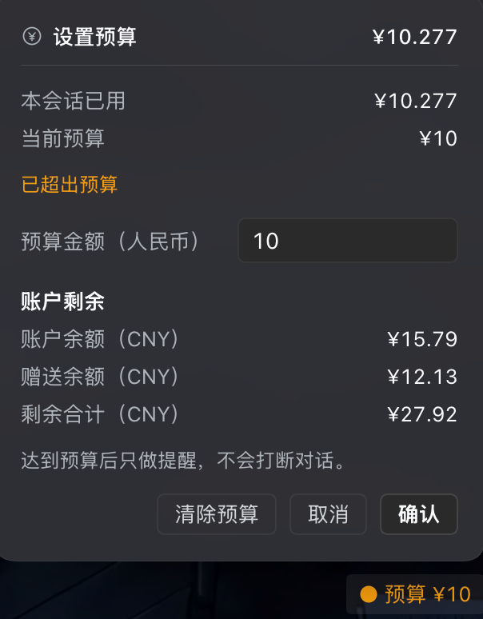
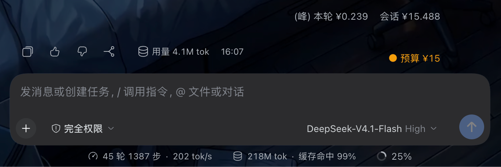
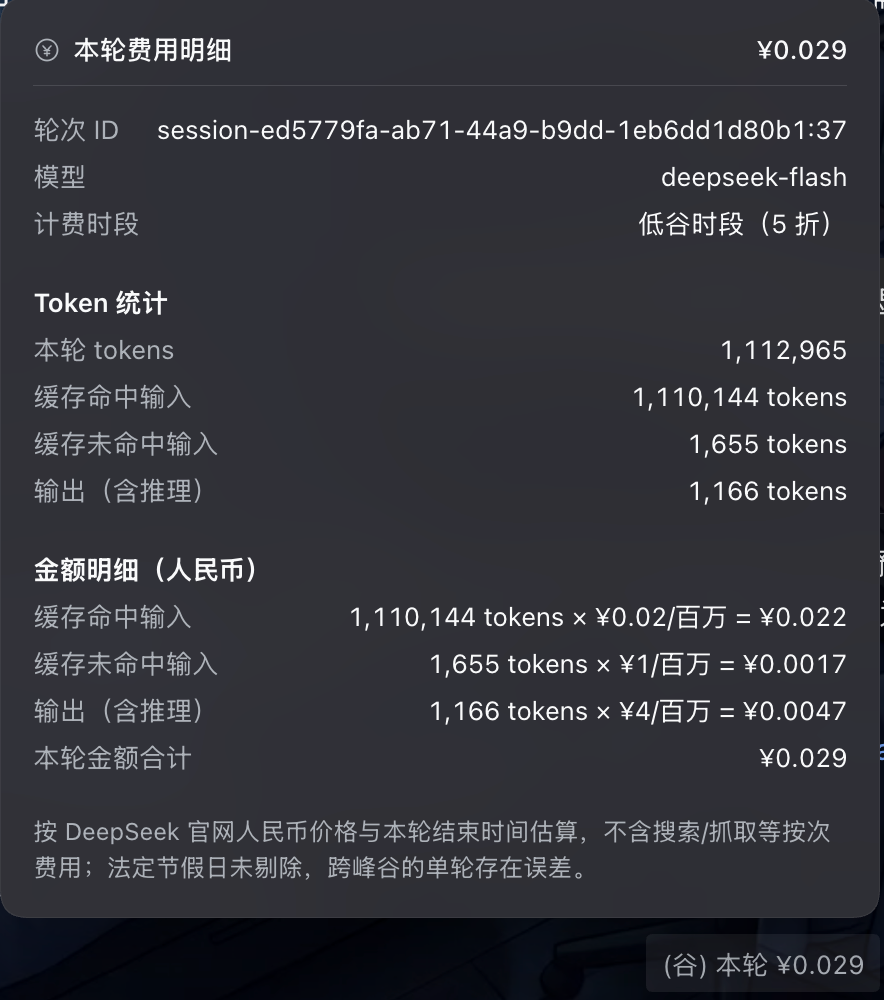
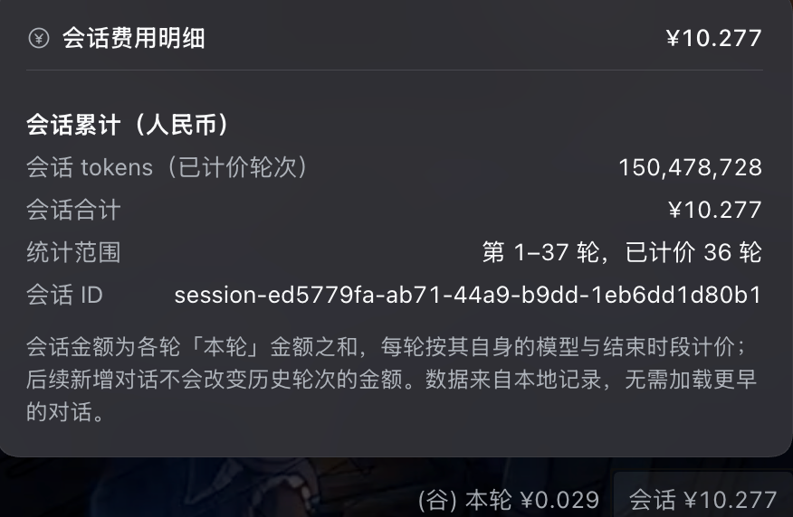
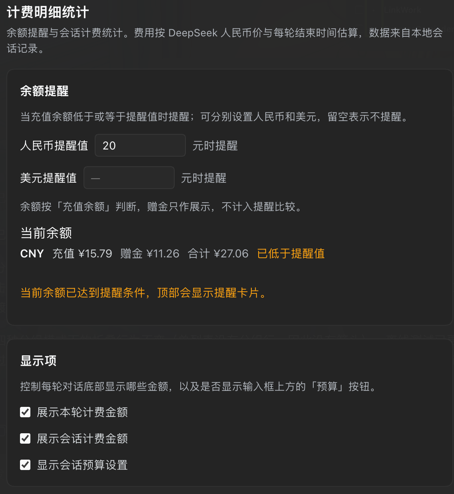
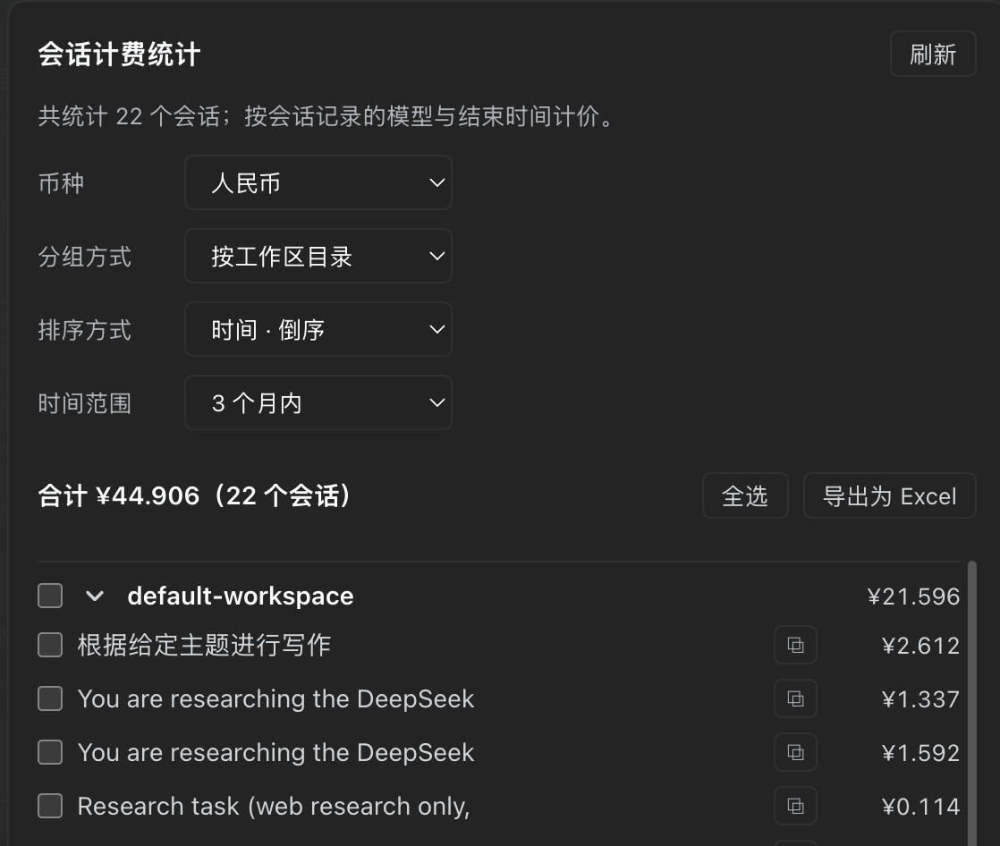

# dsh-plugin-turn-cost

> Per-turn cost · session totals · budget and balance reminders · billing dashboard · Excel export · CNY/USD

Show what each conversation turn and the whole session cost, right under the token usage — plus budget and balance reminders, a full billing dashboard, and Excel export.

```
Usage 19.2k
(off-peak) This turn $0.027    Session $0.151
```

## Screenshots

**Set budget**: open the budget pill in the composer tool row to see this session's usage and current budget and adjust it; account balance, bonus balance and the remaining total are shown here too.



**Footer amounts and the budget pill**: the label turns orange when the session is over budget.



**Turn cost detail**: click “This turn” to see the turn ID, model, billing period, token buckets and the per-bucket cost.



**Session cost detail**: click “Session” to see the current session's tokens, session total, the priced range and the session ID.



**Balance reminder and display toggles**: CNY/USD thresholds, current balance, and the three switches that control the footer amounts and the budget pill.



**Billing statistics**: all sessions in one place — switch currency, grouping, sorting and time range, then select sessions and export to Excel.



## What problem it solves

- **Token numbers don't tell you the cost**: DSH shows tokens, DeepSeek bills per token. This plugin shows the price of each turn and the cumulative session cost right where the turn ends, so there is no mental arithmetic.
- **Long conversations hide the running total**: costs pile up silently and past turns are hard to account for. Each turn's amount is frozen and the cumulative figure never rewrites history.
- **Budgets and balances surprise you**: set a per-session budget and per-currency balance thresholds, and get an early warning instead of discovering an empty account.
- **Many sessions, no overview**: every session's cost lives on one settings page, filterable by workspace/time/currency, sortable, selectable and exportable to Excel for accounting.
- **History must be loaded to compute**: cost records are kept locally, so the last turns are correct without loading earlier history, and session renames are reflected.
- **Mixed languages and currencies**: CNY and USD each follow DeepSeek's own official price list (never an FX conversion); the English UI shows USD automatically.

In short: **it turns "how much did these tokens cost?" from invisible and hard to reconstruct into per-turn clarity, per-session traceability, early warnings and exportable records.**

## Features

- **This turn / session cost** — the estimated cost of the turn and the cumulative session cost up to that turn. Earlier turns never change when new turns arrive.
- **Detail popovers** — "This turn" shows token usage, billing period, per-bucket unit prices and amounts; "Session" shows cumulative tokens, stats range and the Session ID.
- **Peak / off-peak tag** — `(peak)` / `(off-peak)` follows the turn's own end time (off-peak is 50% off). Retired models with flat pricing get no tag.
- **Budget reminder** — a persistent "$ Budget N" pill in the composer tool row (left of the model selector; only the currency symbol when the composer is narrow), usable in a new conversation or mid-conversation. When the session total reaches the budget the label turns orange, as a warning that never interrupts the conversation.
- **Balance reminder** — set separate CNY and USD thresholds under Settings; you are notified once when the balance drops below the threshold, with "Remind me later" (silent for the rest of the day) and "Don't remind again" (silent until the balance recovers and dips again).
- **Session billing statistics** — a dedicated settings page listing every session's cost, grouped by workspace directory / workspace tree / flat list, sortable by name or time, filtered by today / 7 days / 1 / 3 / 6 months / 1 year.
- **Selection and Excel export** — select sessions or whole groups (or select all) and export the selection to an Excel workbook. Exporting with nothing selected shows "Nothing selected".
- **Currency switch** — the statistics page has a Currency selector (CNY / USD). Every amount and symbol follows it; USD amounts are cached locally so switching back and forth never recomputes.
- **Local records** — per-turn and per-session costs are stored in `localStorage`, so the last turns are correct without loading earlier history; renaming a session updates the stored title.

## How to use

1. **Install** — install the repository `https://github.com/jerodji/dsh-plugin-turn-cost` with `plugin_manager` (or clone it and install the local folder), then force-refresh the page (⌘⇧R). Requires DSH `>= 0.2.2-alpha.3`.
2. **Read costs** — after a completed turn, the two amounts appear under the token usage line; click either to open its detail card, click the backdrop or press Esc to close.
3. **Set a budget** — click the "Budget" pill in the composer tool row, enter an amount and confirm. Over budget, the whole label turns orange; when the composer is narrow the pill shows only the currency symbol.
4. **Set balance thresholds** — Settings → "Billing details" → "Balance reminder", fill in the CNY and USD thresholds.
5. **Review all sessions** — Settings → "Billing details" → "Session billing statistics": choose grouping, sorting, time range and currency; tick sessions or groups and click "Export to Excel".
6. **Control visibility** — the "Display" card on the same page can hide This turn / Session / the budget pill individually.

## How the numbers are calculated

- **DeepSeek models**: estimates based on DeepSeek's official price lists; CNY and USD each use their own official table, **never an FX conversion**.
- **Third-party models** (other providers you connect): priced from the **offline model catalog bundled with DSH** (pi-ai, USD per 1M tokens) — no network needed, available at startup. In CNY mode the amount is approximated at 1 USD ≈ ¥7.10 and marked with `≈`.
- Models whose catalog rates are all 0 show `¥0` (`$0` in USD mode); models absent from the catalog show `¥??` (`$??`) and are excluded from the session total, so a session with priced turns becomes a `≥` lower bound.
- Subscription plans (ChatGPT Pro, GitHub Copilot, GLM / Kimi Coding, Token Plan) have no per-token price: the turn shows "This turn consumed subscription quota" and is excluded from money totals. A plan-only session shows "Session consumed subscription quota"; with priced turns it shows `Session ≥ ¥12` / `≥ $12`.
- `(peak)` / `(off-peak)` appears only for models billed by DeepSeek's peak/off-peak table; plan, free, unknown and other third-party models carry no tag.
- Each footer shows the model and reasoning effort used for that turn (e.g. `DeepSeek-V4.1-Flash High`). The model name matches the picker (host llm catalog first, bundled catalog name as fallback); the effort comes from the request header, and since the log records that header only once per process start, later turns carry forward the last known effort. Replayed historical turns get the label too.
- Peak hours are weekdays 09:00–12:00 and 14:00–18:00 Beijing time; everything else is off-peak at 50% off, judged by **each turn's own end time** (DeepSeek only; catalog prices are flat all day).
- Web search / fetch is billed per successful request (¥5 or $0.75 per 1,000), only for the new Search/Fetch API and only for DeepSeek models.
- Statutory holidays are not excluded, and turns spanning peak/off-peak are priced by their end time — both are approximations.
- Turns aborted without any reply show no badge and count as 0.

## Compatibility

| DSH version | Status |
| --- | --- |
| 0.2.2-rc.1 (the build used for testing) | ✅ Everything works |
| 0.2.2-alpha.3 and later | ✅ Everything works |
| 0.1.7-rc.2 – 0.2.2-alpha.2 | ⚠️ Core features work (footer amounts, detail dialogs, budget, balance reminder, billing statistics, Excel export); no Settings nav icon (that slot exists only from 0.2.2-alpha.3); session-list payloads carry this plugin's projection data (the `wire.summary` optimisation exists only from 0.2.2-alpha.2) |
| 0.1.6-alpha.2 – 0.1.6 | ⚠️ Expected to work (the first builds with external-plugin installation), not verified on a real app |
| Below 0.1.6-alpha.2 | ❌ No external-plugin installation support; this plugin cannot be installed |

Summary: **0.2.2 or later is recommended**; 0.1.6-alpha.2 is the earliest installable build, but 0.1.6/0.1.7-rc releases are early previews and degrade placement/icons. The older-version conclusions come from static inspection of each package version; only 0.2.2-rc.1 was tested live.

## Privacy and limits

- All cost data stays in local `localStorage`; nothing is uploaded.
- Only token and web-tool costs are counted; the account balance comes from DSH's account API.
- Targets the DSH web UI; large UI changes in future DSH versions may affect placement.

Design details, data structures and development notes: see [DETAILS.md](DETAILS.md).
