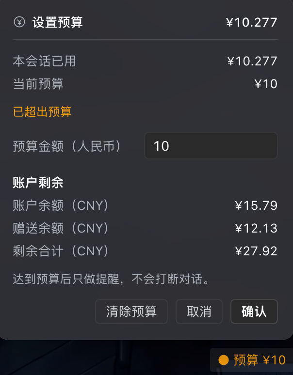
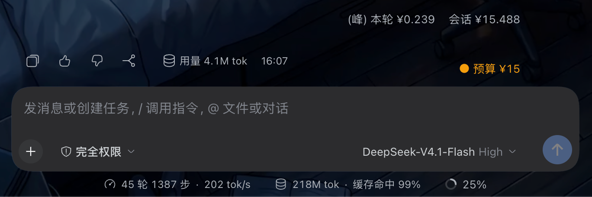
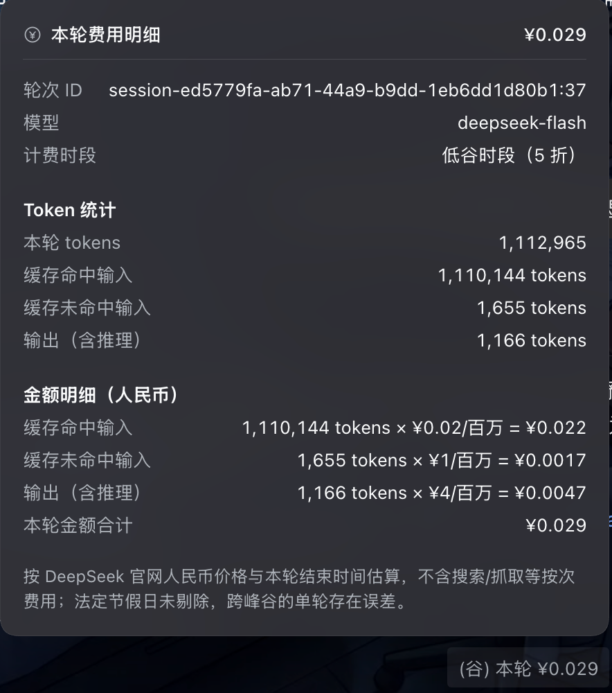
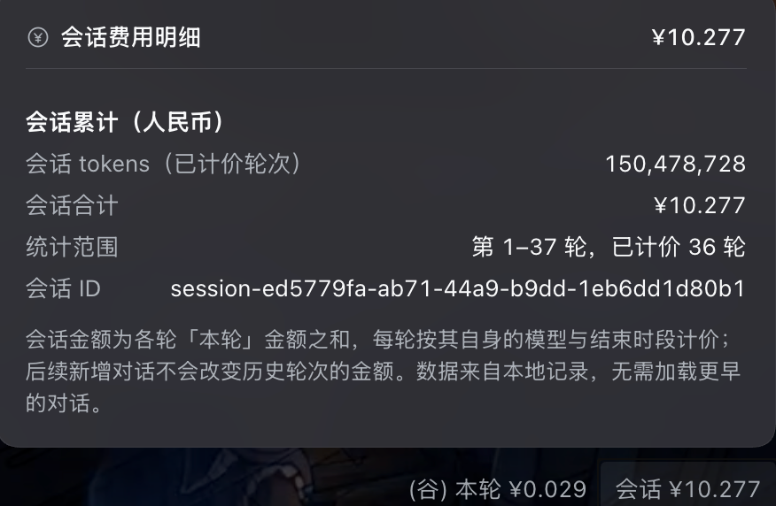
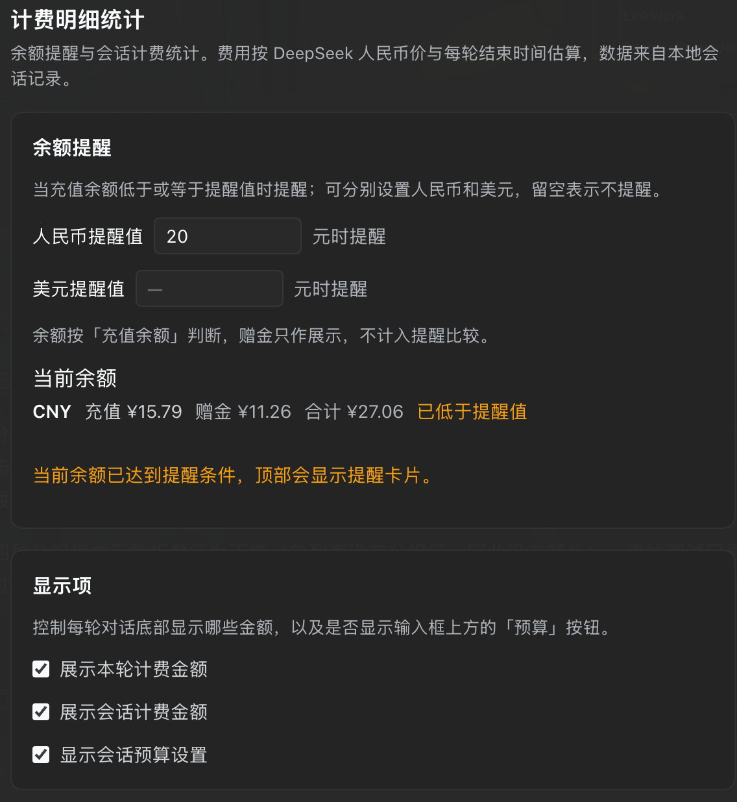
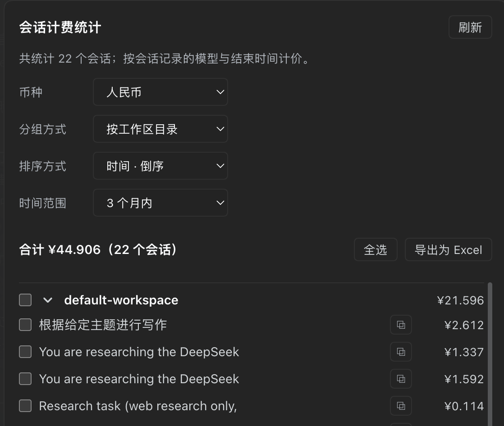

# dsh-plugin-turn-cost

> 每轮对话费用 · 会话累计 · 预算与余额提醒 · 计费明细统计 · Excel 导出 · 人民币/美元

> **所有金额都是估算值，仅供参考，以 DeepSeek 官方账单为准。** 插件不参与计费：金额由本机会话日志里的 token 用量、内置的官方价目表（人民币 / 美元各一套）、内置的 2025–2027 年法定节假日表，以及仅用于展示换算的近似汇率（1 USD ≈ ¥7.1）推算得出；实际扣费可能与本插件显示的数字不同。

在每轮对话底部显示这一轮以及整个会话花了多少钱，并且支持预算提醒、余额提醒和全部会话账单统计（可导出 Excel）。

```
用量 19.2k
DeepSeek-V4.1-Flash High （谷）  本轮 ¥0.189    会话 ¥1.048
```

## 截图

**设置预算**：输入框工具行中的预算按钮点开后，可查看本会话已用/当前预算并调整；账户余额、赠送余额与剩余合计也在这里展示。



**页脚金额与预算胶囊**：超出预算会进行变色提醒。



**单次对话费用明细**：点「本轮」展开，含轮次 ID、模型、计费时段、Token 统计与逐项金额。



**会话费用明细**：点「会话」展开，含当前会话 tokens、会话合计、统计范围与会话 ID。



**余额提醒与显示项**：人民币/美元阈值、当前余额，以及控制页脚与预算按钮显示的三项开关。



**计费明细统计**：所有会话的账单汇总，可按币种、分组方式、排序方式、时间范围查看，勾选后导出 Excel。



## 这个插件解决了什么问题

- **看不懂 token 用量，算不清花了多少钱**：DSH 只在对话底部显示 token 数，而 DeepSeek 按 token 计费。装了它，每轮结束就能直接看到「这一轮多少钱、这个会话累计多少钱」，不用再拿 token 数去手算。
- **长会话不知道总成本，也难以复盘**：会话越聊越长，钱在不知不觉中累积；历史轮次也说不清各花了多少。插件把每轮金额固定下来、累计值随对话冻结，随时可以回头看。
- **容易超预算、余额见底才发现**：可以给单个会话设预算、给账户余额设提醒，达到阈值时提前收到提示，而不是等扣光。
- **会话一多，账单无法汇总**：所有会话的花费集中在一页，按工作区/时间/币种筛选、排序、勾选，并可直接导出 Excel 用于记账或报账。
- **数据要加载才能算**：费用记录保存在本地，不加载更早的对话也能看到最后几轮的正确数字，会话改名也会同步。
- **中英文/双币种环境算不准**：人民币和美元各自按 DeepSeek 官方价目表计价，不套用汇率，英文界面自动显示美元。

简单说：**把「token 烧了多少钱」从看不见、算不清，变成每一轮都清楚、每个会话可追溯、可提醒、可导出。**

## 主要功能

- **本轮 / 会话花费**：每轮对话结束显示该轮估算金额，以及截至这一轮的会话累计金额。历史轮次金额固定不变，后面的对话不会改写前面的数字。
- **明细弹窗**：点「本轮」看 token 用量、计价时段、每个计费桶的单价与金额；点「会话」看累计 tokens、统计范围、会话 ID。
- **子代理花费**：协作会话里，「本轮」会自动加上归入本轮的子代理花费，明细多出「子代理（N）」分段逐项列出；「本会话」包含截至该轮结束前整个会话内所有子代理（同一子代理跨多轮合并）的累计花费。子代理按自身轮次结束时间归入父轮，属估算，以官方账单为准。
- **峰谷标记**：`（峰）` / `（谷）` 表示该轮结束在高峰还是低谷（低谷 5 折），显示在模型名与推理等级之后；「本轮」按钮只显示金额。已下线、全天同价的模型不加标记。
- **预算提醒**：输入框工具行常驻「¥ 预算 N」（模型选择器左侧；输入框变窄时只显示币种符号），新对话或进行中的对话都能点开设置/调整。本会话累计达到预算时文字变橙提醒，只提醒、不打断。
- **余额提醒**：在设置里为人民币、美元分别设置阈值，余额（充值余额）低于阈值时提醒一次；支持「稍后提醒」（当天不再提醒）和「不再提醒」（直到余额回升后再次跌破才提醒）。
- **计费明细统计**：独立设置页，列出每个会话的花费，支持按工作区目录 / 工作区树 / 单列表分组，按名称或时间排序，按当天 / 7 天 / 1 月 / 3 月 / 半年 / 1 年筛选。
- **勾选与导出**：每个会话、每个分组都能勾选（支持全选），选中后导出为 Excel；未选中时点击导出会提示「当前没有选中」。
- **币种切换**：统计页的「币种」可在人民币 / 美元间切换，全界面金额与符号同步变化，美元金额会缓存在本地，来回切换不重算。
- **本地记录**：每轮、每个会话的费用都记录在本地（`localStorage`），不需要加载更早的对话就能显示正确数据；会话重命名后记录里的名字也会同步。

## 如何使用

1. **安装**：用 `plugin_manager` 安装仓库地址 `https://github.com/jerodji/dsh-plugin-turn-cost`（或先 clone，再安装本地目录），安装完成后强制刷新页面（⌘⇧R）。需要 DSH `>= 0.2.2-alpha.3`。
2. **看花费**：对话结束后，底部 token 用量下方会出现「本轮 / 会话」两个金额；点它们看明细，点空白处或按 Esc 关闭。
3. **设预算**：点输入框工具行里的「预算」按钮，输入金额确认。超出预算时按钮文字变橙；输入框变窄时按钮只显示「¥」/「$」。
4. **设余额提醒**：设置 →「计费明细统计」→「余额提醒」，分别填人民币、美元阈值。
5. **看全部账单**：设置 →「计费明细统计」→「会话计费统计」，选择分组方式、排序方式、时间范围、币种；勾选需要的会话或分组，点「导出为 Excel」。
6. **控制显示项**：同一页面「显示项」里可分别关闭「本轮」「会话」「预算」的显示。

## 统计说明

- **DeepSeek 模型**：按 DeepSeek 官方价目估算，人民币与美元各用自己的官方价目表，**不做汇率换算**。
- **第三方模型**（你自己接入的其他服务商）：按 DSH 内置的离线模型目录（pi-ai，美元 / 百万 tokens）计价，**完全离线、启动即可用**；人民币模式下按 1 美元 ≈ ¥7.10 近似折算，金额前标 `≈`。
- **国产模型（智谱 GLM、Kimi、千问、豆包 / Seed）**：人民币模式下按各厂商**官方人民币价目**（元 / 百万 tokens）精确计价、不加 `≈`；美元模式下按内置美元价目计价。两张价目表各自独立，**不做汇率折算**（例如 GLM-5.3 官方人民币价为输入 ¥8、输出 ¥28，并非目录美元价 × 7.1）。人民币价目保存在插件本地的 `prices/cny-models.json`，厂商调价时只需更新这个文件并重启 DSH；表里没有收录的模型仍回落到目录价 + `≈`。DeepSeek 继续使用内置的官方人民币 / 美元价目与峰谷规则。
- 目录里价格全为 0 的模型显示 `¥0`（美元模式 `$0`）；目录里查不到价格的模型显示 `¥??`（美元模式 `$??`），不计入会话合计，前面已有计价轮次时会话显示 `≥`。
- 订阅套餐（月 / 季 / 年套餐，如 ChatGPT Pro、GitHub Copilot、Claude Pro/Max、GLM / Kimi Coding、Token Plan）无法按 token 计算单轮价格，本轮显示「本轮消耗订阅额度」，不计入金额合计；整段会话都是订阅额度时显示「会话消耗订阅额度」，有已计价轮次时显示 `会话 ≥ ¥12` / `≥ $12`。按量付费的 API 接入（包括用 OAuth 登录但按 token 扣费的网关，如 OpenRouter，以及 API key 接入）不属于套餐：按该模型目录价格 × token 计算实际费用，并写入投影和浏览器本地记录。提供方 id 里含 `coding` / `token-plan` 也不代表套餐——只要实际存的是 API key（例如 GLM 的 coding 端点），就按 token 计费。
- `（峰）` / `（谷）` 只出现在按 DeepSeek 峰谷价计费的模型上，挂在模型名与推理等级后面（如 `DeepSeek-V4.1-Flash High （谷）`）；「本轮」按钮只显示「本轮 ¥0.857」；套餐、免费、未知和其他第三方模型都不带标记。
- 每轮「本轮」按钮前会显示该轮实际使用的模型与推理等级（例如 `DeepSeek-V4.1-Flash High`）：模型名与输入框选择器一致（优先宿主 llm 目录，离线目录名兜底），推理等级按轮记录：插件从宿主 `agent/pre-step` 读取该轮实际解出的推理等级，写入 `~/.dsh/turn-cost-selections.json`，重启后仍按本地记录显示；模型名用普通灰色、等级用浅灰。
- 高峰时段为北京时间周一至周五 09:00–12:00、14:00–18:00，其余时间按低谷价（5 折）；按**每轮自己的结束时间**判断（仅 DeepSeek 模型有峰谷；目录价格全天同价）。
- 联网搜索 / 网页抓取按成功请求数计费（¥5 或 $0.75 / 1000 次），只统计新版 Search/Fetch API 的调用，且只对 DeepSeek 模型计入。
- 法定节假日按内置的 2025–2027 年表剔除（表外年份按周一至周五近似），跨峰谷的轮次按结束时间取价，属于近似值。
- 中止且没有任何回复的轮次不显示徽标，按 0 计入累计。
- **子代理花费**：子代理在独立会话中按自身轮次计费，父会话按「子代理轮次结束时间落在哪一轮」归因（本轮结束后徽标才出现，金额随即固定）；续跑的子代理名字来自会话级成员记录，缺失时退回子会话标题 / 会话 ID 前 8 位；套餐类子代理显示「订阅额度」、不计入金额。仍为估算，以官方账单为准。

## 兼容性

| DSH 版本 | 状态 |
| --- | --- |
| 0.2.2-rc.1（本机实测版本） | ✅ 全部功能正常 |
| 0.2.2-alpha.3 及以上 | ✅ 全部功能正常（`engines.dsh` 声明的下限） |
| 低于 0.2.2-alpha.3 | ❌ 不支持：插件依赖该版本起提供的设置页插槽，且 `engines.dsh` 会阻止安装 |

结论：**需要 DSH 0.2.2-alpha.3 及以上**（`package.json` 的 `engines.dsh` 即此下限），推荐 0.2.2 及以上；本机实测为 0.2.2-rc.1。

## 隐私与限制

- 所有费用数据只保存在本机 `localStorage`，不上传任何服务器。
- 仅统计 token 与联网工具费用；账户余额来自 DSH 的账户接口。
- 目前面向 DSH Web 界面；不同版本的界面结构变化可能影响显示位置。

实现细节、数据结构与开发说明见 [DETAILS.md](DETAILS.md)。
